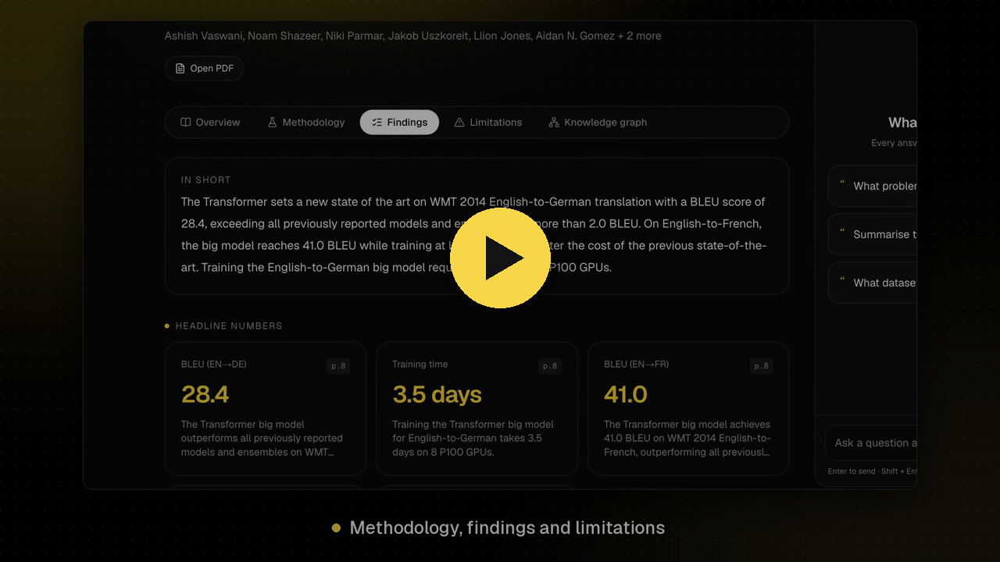

# Research Buddy

**Your AI reading partner for research papers.** Upload a PDF or paste a paper link. Research Buddy reads the paper, generates a structured breakdown and a knowledge graph, and lets you ask questions with answers cited to the exact page and section.

---

## Demo

[](docs/demo.mp4)

_60-second walkthrough: upload "Attention Is All You Need", explore the generated breakdown and knowledge graph, then ask a question with cited answers. Click to play._

---

## Features

When a paper is added, Research Buddy automatically generates:

| # | Feature | What you get |
|---|---------|--------------|
| 1 | **Paper overview** | Title, authors, abstract, research objective and key contributions |
| 2 | **Methodology breakdown** | Plain-language summary, each technique explained, models and datasets used |
| 3 | **Key findings** | Results table with metrics, values and page numbers |
| 4 | **Limitations** | Weaknesses and future research directions |
| 5 | **Knowledge graph** | Interactive graph of concepts, methods, models, datasets, tasks and metrics and how they relate |
| 6 | **Interactive Q&A** | Chat with the paper; answers stream in with clickable citations showing the page, section and source text |

Supported sources: **PDF upload**, **arXiv** (links or IDs like `1706.03762`), **OpenReview**, **DOI**, **ACL Anthology**, direct `.pdf` links, and any page that exposes a `citation_pdf_url` meta tag.

---

## Tech Stack

**Frontend**
- [Next.js 16](https://nextjs.org/) (App Router) + TypeScript
- [Tailwind CSS v4](https://tailwindcss.com/) + [shadcn/ui](https://ui.shadcn.com/) (Base UI)
- [Zustand](https://zustand.docs.pmnd.rs/) for state management (auth, papers, chat)
- `react-force-graph-2d` for the knowledge graph, `react-markdown` for answers

**Backend & AI**
- [FastAPI](https://fastapi.tiangolo.com/) with JWT auth (bcrypt + PyJWT)
- [MongoDB](https://www.mongodb.com/) (local) for users, papers, analysis and chat history
- [ChromaDB](https://www.trychroma.com/) (embedded, persistent) as the vector store
- [Docling](https://github.com/docling-project/docling) for PDF parsing and its **HybridChunker** for chunking
- [Nomic Embed v1.5](https://huggingface.co/nomic-ai/nomic-embed-text-v1.5) for embeddings (runs locally)
- **BM25** (`rank-bm25`) for keyword search
- [BGE Reranker](https://huggingface.co/BAAI/bge-reranker-base) cross-encoder for reranking
- [LangGraph](https://langchain-ai.github.io/langgraph/) + [LangChain](https://www.langchain.com/) for the agent workflows
- [OpenRouter](https://openrouter.ai/) free models for the LLM, with an ordered fallback chain

---

## How It Works

### User flow

```
Landing page ──▶ Sign up / Sign in ──▶ Dashboard ──▶ Upload PDF or paste link
                                                            │
                     ┌──────────────────────────────────────┘
                     ▼
        Status: Downloading → Parsing → Indexing → Analysing → Ready
                     │
                     ▼
        Paper workspace
          ├─ Tabs: Overview · Methodology · Findings · Limitations · Knowledge graph
          └─ Chat panel: ask questions → streamed answers with [1][2] citations
                                          → click a citation to see page, section & text
```

Chat becomes available once indexing finishes, while the insights are still being generated.

### Ingestion pipeline

```
Link ──▶ PaperDownloader (detects source: arXiv / OpenReview / DOI / PDF / web)
                │
PDF  ───────────┴──▶ Docling (layout-aware parsing)
                          │
                          ▼
                   HybridChunker (≤512 tokens, section headings kept)
                          │
                          ▼
                   Nomic embeddings ──▶ ChromaDB (with page + section metadata)
                          │
                          ▼
                   LangGraph analysis agent (5 sections generated in parallel)
                          │
                          ▼
                       MongoDB
```

### Retrieval pipeline (hybrid search + reranking)

```
Question ──▶ (follow-ups rewritten into standalone queries)
               │
       ┌───────┴────────┐
       ▼                ▼
  Dense search      BM25 keyword
  (Nomic+Chroma)    search
   top 20            top 20
       └───────┬────────┘
               ▼
   Reciprocal Rank Fusion → top 20
               ▼
   Cross-encoder reranker (BGE) → top 5
               ▼
   LLM answers with numbered citations (streamed over SSE)
```

### LLM fallback chain

Structured outputs (the 5 analysis sections) use OpenRouter's `json_schema` mode with `require_parameters`, so only models that enforce the schema are used. Models are tried in order:

1. `nvidia/nemotron-3.5-super-vl:free`
2. `dots-studio/dots-3-note-preview:free`
3. `xingchen-agi/xing4.0-29b-a4b:free`
4. `liquid/lfm-2.5-2.6b:free`
5. `openrouter/free` (last resort: the schema goes in the prompt and the reply is validated with Pydantic)

The list is configurable in `.env`.

---

## Project Structure

```
research-buddy/
├── backend/
│   ├── app/
│   │   ├── main.py              # FastAPI app, CORS, routers
│   │   ├── api/
│   │   │   ├── deps.py          # auth dependency (current_user)
│   │   │   └── routes/          # auth.py, papers.py, chat.py
│   │   ├── core/                # config, database, vectorstore, security
│   │   ├── models/              # Pydantic schemas (user, paper, analysis, chat)
│   │   ├── services/            # downloader, ingestion, retrieval, analysis, qa, papers
│   │   ├── agents/              # LangGraph graphs: analysis_graph.py, qa_graph.py
│   │   └── helpers/             # llm, embeddings, reranker, text
│   ├── requirements.txt
│   └── .env.example
├── frontend/                    # the web app (port 3000)
│   └── src/
│       ├── app/                 # routes: /auth, /dashboard, /papers/[id]  (/ redirects to the dashboard)
│       ├── api/                 # client.ts, auth.ts, papers.ts, chat.ts
│       ├── store/               # Zustand stores: auth, papers, chat
│       ├── components/          # ui/ (shadcn), common/, auth/, dashboard/, paper/, chat/, layout/
│       ├── hooks/               # useAuth, usePolling, useAddPaper
│       ├── helpers/             # format, sse, source, urls
│       └── types/
└── landing/                     # standalone marketing site (port 3001), deploys on its own
    ├── public/logos/            # tech-stack logos
    └── src/
        ├── app/                 # single page: /
        ├── components/          # landing/ sections, common/ (motion helpers), layout/ (logo)
        └── hooks/               # useIsDeployed
```

The **landing page** is its own Next.js app with no backend or auth code, so it can be deployed by itself (Vercel, Netlify, any static host — it builds to static HTML). On localhost its buttons open the app; on a deployed domain they become **Watch demo** and link to the demo video in this README.

---

## Getting Started

### Prerequisites

- **Python 3.12** and [uv](https://docs.astral.sh/uv/) (or plain `pip`)
- **Node.js 20+**
- **MongoDB** running locally on `mongodb://localhost:27017`
  (macOS: `brew tap mongodb/brew && brew install mongodb-community && brew services start mongodb-community`)
- An **OpenRouter API key** from [openrouter.ai/keys](https://openrouter.ai/keys) (free models work)

ChromaDB needs no separate install. It runs inside the backend and stores its data in `backend/data/chroma`.

### 1. Clone

```bash
git clone https://github.com/abrxrk/research-buddy.git
cd research-buddy
```

### 2. Backend

```bash
cd backend
uv venv -p 3.12 .venv
uv pip install -p .venv -r requirements.txt
# or: python3.12 -m venv .venv && .venv/bin/pip install -r requirements.txt

cp .env.example .env
# edit .env → set OPENROUTER_API_KEY and a random JWT_SECRET
#   python3 -c "import secrets; print(secrets.token_urlsafe(48))"

.venv/bin/uvicorn app.main:app --reload --port 8000
```

Or simply run **`bash start.sh`** from `backend/`. It finds (or creates) the virtualenv, activates it, installs `requirements.txt` only when it has changed, checks `.env` and MongoDB, then starts the server on port 8000 with auto-reload (`PORT=9000 bash start.sh` or `bash start.sh --no-reload` to change that).

API docs: http://localhost:8000/docs

> **First run:** Nomic and the reranker are downloaded and loaded in the background when the server starts, so they're ready before your first request. Docling's PDF models (~1–2 GB in total with the others) download the first time a paper is processed, so the first paper takes a few extra minutes. Downloads are cached in `~/.cache/huggingface`; later starts only load from disk.

### 3. Frontend

```bash
cd frontend
npm install
cp .env.example .env.local   # NEXT_PUBLIC_API_URL=http://localhost:8000
npm run dev
```

Open http://localhost:3000

### 4. Landing page (optional)

```bash
cd landing
npm install
cp .env.example .env.local   # NEXT_PUBLIC_APP_URL=http://localhost:3000
npm run dev
```

Open http://localhost:3001

### Environment variables

**`backend/.env`**

| Variable | Description | Default |
|----------|-------------|---------|
| `OPENROUTER_API_KEY` | OpenRouter API key | — (required) |
| `LLM_MODELS` | JSON array of free models, tried in order | 4 structured-output free models |
| `LLM_FALLBACK_MODEL` | Last-resort model | `openrouter/free` |
| `MONGO_URI` | MongoDB connection string | `mongodb://localhost:27017` |
| `MONGO_DB` | Database name | `research_buddy` |
| `JWT_SECRET` | Secret used to sign auth tokens | — (required) |
| `CHROMA_DIR` | ChromaDB storage folder | `data/chroma` |
| `UPLOAD_DIR` | Uploaded / downloaded PDFs folder | `data/uploads` |
| `FRONTEND_ORIGIN` | Allowed CORS origin | `http://localhost:3000` |

**`frontend/.env.local`**

| Variable | Description | Default |
|----------|-------------|---------|
| `NEXT_PUBLIC_API_URL` | Backend URL | `http://localhost:8000` |
| `NEXT_PUBLIC_LANDING_URL` | Where "Log out" takes you | `http://localhost:3001` |

**`landing/.env.local`**

| Variable | Description | Default |
|----------|-------------|---------|
| `NEXT_PUBLIC_APP_URL` | App URL the landing buttons open (when running locally) | `http://localhost:3000` |

---

## API Overview

| Method | Endpoint | Description |
|--------|----------|-------------|
| `POST` | `/auth/signup` | Create account → JWT |
| `POST` | `/auth/login` | Sign in → JWT |
| `GET` | `/auth/me` | Current user |
| `POST` | `/papers/upload` | Upload a PDF (multipart) |
| `POST` | `/papers/link` | Add a paper from a link |
| `GET` | `/papers` | List your papers |
| `GET` | `/papers/{id}` | Paper with status and analysis |
| `DELETE` | `/papers/{id}` | Delete paper, its vectors and chat |
| `GET` | `/papers/{id}/pdf` | Original PDF |
| `POST` | `/papers/{id}/retry` | Re-run processing for a failed paper |
| `GET` | `/papers/{id}/chat` | Chat history |
| `POST` | `/papers/{id}/chat` | Ask a question (Server-Sent Events: `sources`, `token`, `done`) |
| `DELETE` | `/papers/{id}/chat` | Clear chat history |

---

## Notes

- **Free-model limits:** OpenRouter allows ~20 requests/min and 50/day on free models (1000/day once you've bought $10 of credits). Each paper uses 5 calls for analysis, plus about 1–2 per chat question. Free models can be slow, so analysis can take a few minutes.
- One paper is ingested at a time to keep memory use reasonable.
- If the server restarts mid-processing, that paper is marked failed. Re-upload it to try again.
